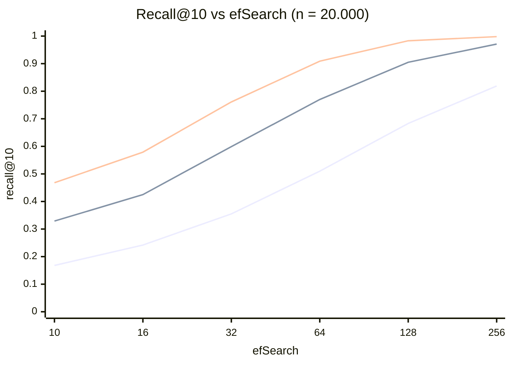
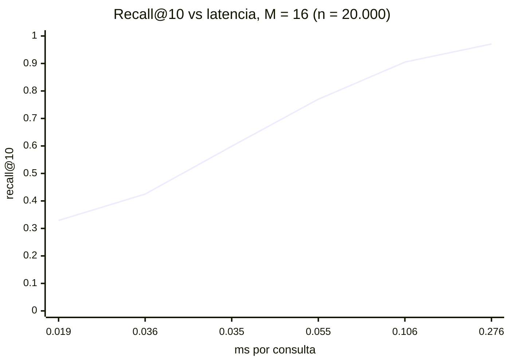

# Respuestas del workshop RAG
Escribe aquí tus respuestas con tus propias palabras. Pega tablas, resultados y enlaces a las capturas de `evidencias/`.

---

# Bloque 0 · Teoría

## T1 · Cuántos nodos viven en cada capa

_Evidencia:_ cálculo a mano + simulación en Python (abajo).

_Mi respuesta / análisis:_

Con M = 16, la probabilidad de que un vector llegue al menos a la capa k es 16⁻ᵏ. Con N = 1.000.000:

| Capa | Teórico (a mano) | Simulado |
|---|---:|---:|
| ≥ 1 | 1.000.000 / 16 = 62.500 | 62.085 |
| ≥ 2 | 1.000.000 / 256 ≈ 3.906 | 3.972 |
| ≥ 3 | 1.000.000 / 4.096 ≈ 244 | 231 |

```python
import numpy as np, math
rng = np.random.default_rng(42); N = 1_000_000; M = 16; mL = 1 / math.log(M)
l = np.floor(-np.log(rng.random(N)) * mL).astype(int)
for k in (1, 2, 3): print(k, N / M**k, (l >= k).sum())   # capa máxima obtenida: 5
```

La simulación coincide con la teoría: cada capa tiene unas 16 veces menos nodos que la de abajo.

Que haya pocos hubs arriba es bueno porque en las capas altas la búsqueda da "saltos largos" entre muy pocos nodos y llega rápido a la región correcta del espacio. Después solo tiene que refinar en las capas bajas, en vez de recorrer el millón de nodos de la capa 0.


## T2 · ef, k y el tamaño de la cola

_Mi respuesta / análisis:_

1. **k = 10 con ef = 5:** la cola de candidatos solo guarda 5 elementos, así que la búsqueda no puede devolver 10 vecinos (o devuelve menos de los pedidos). Por eso ef debe ser siempre ≥ k.
2. **Valor inicial:** conviene empezar con ef igual o un poco mayor que k, y subirlo cuando el recall no es suficiente. Más ef mejora la precisión pero hace cada consulta más lenta.
3. **Cambiable en producción:** **ef** (ef_search), porque solo controla cuántos candidatos se exploran al buscar. **ef_construction** se usó para decidir las conexiones al construir el grafo; cambiarlo implica reconstruir el índice.


## T3 · Inserción frente a búsqueda

_Mi respuesta / análisis:_

| | Inserción | Búsqueda | Por qué |
|---|---|---|---|
| ¿Se sortea la capa? | Sí | No | Solo un vector nuevo necesita una capa máxima; la consulta no se guarda en el grafo, solo lo recorre desde la entrada. |
| Valor de ef en las capas altas | 1 | 1 | En las capas altas solo interesa bajar rápido hacia el vecino más cercano; con 1 candidato basta. |
| Parámetro de la fase principal | ef_construction | ef (ef_search) | Al insertar, ef_construction define cuántos candidatos se evalúan para elegir buenas conexiones; al buscar, ef define cuántos se exploran para encontrar los k vecinos. |
| ¿Modifica el índice? | Sí | No | La inserción agrega el nodo y sus aristas; la búsqueda es solo lectura. |

En el notebook 03, `vectorstore.add_documents(...)` dispara la **inserción** y `retriever.invoke(...)` dispara la **búsqueda**.


## T4 · El invariante de FAISSVectorStore

_Mi respuesta / análisis:_

| Posición | Antes | Después de borrar B (solo en `self.documents`) |
|---|---|---|
| 0 | A | A |
| 1 | B | C |
| 2 | C | D |
| 3 | D | — (no existe) |

FAISS no se enteró del borrado, así que una búsqueda que antes daba [1, 2, 3] (B, C, D) sigue devolviendo los índices [1, 2, 3], pero ahora se traducen a **[C, D, IndexError]**:

- Posiciones 1 y 2 → **error silencioso**: devuelven C y D cuando el vector encontrado era el de B y el de C. La respuesta es equivocada y no hay ninguna excepción.
- Posición 3 → **lanza excepción** (IndexError), porque la lista ya solo tiene 3 elementos.

Mantener sincronizados a mano dos estructuras (índice y lista de documentos) es frágil. Bases vectoriales como Qdrant guardan el vector, el payload y un id en el mismo registro, y permiten borrar o actualizar por id, así que este desajuste no puede ocurrir.


## T5 · El costo de la fuerza bruta

_Mi respuesta / análisis:_

1.000.000 vectores × 768 dimensiones ≈ 7,68 × 10⁸ multiplicaciones por consulta.
Con 100 consultas por segundo: 7,68 × 10⁸ × 100 = **7,68 × 10¹⁰ multiplicaciones por segundo**.

Ser exacto deja de ser viable porque ese costo crece linealmente con el número de vectores: cada consulta tiene que compararse contra todo el corpus, y con más datos o más usuarios la latencia y el hardware necesario se disparan.

En ANN se sacrifica un poco de exactitud (a veces no se devuelve el vecino más cercano real, recall < 100 %) y a cambio se gana muchísima velocidad, porque solo se visita una fracción pequeña de los vectores.


---

# Bloque A · App RAG empresarial

## A1 · Ejecuta la app RAG de punta a punta

_Evidencia:_ [notebooks/02b_rag_app_nvidia_nim_colab.ipynb](notebooks/02b_rag_app_nvidia_nim_colab.ipynb) (celdas ejecutadas; la celda final corre [experimentos_02b.py](notebooks/experimentos_02b.py)). Captura de la app: [evidencias/A2_corpus.png](evidencias/A2_corpus.png).

_Mi respuesta / análisis:_

El modelo de generación original (`nvidia/nemotron-3-super-120b-a12b`) devolvía **404** con mi cuenta, así que lo cambié por `nvidia/nemotron-3.5-lightning-30b-a3b` con `max_completion_tokens=4000` (con menos tokens las respuestas salían vacías porque es un modelo de razonamiento). Con los 4 documentos de demostración, k = 3 y threshold = 0.3:

| # | Pregunta | Respuesta del RAG | Fuentes recuperadas | ¿Correcta? |
|---|---|---|---|:---:|
| 1 | ¿Precio del plan Enterprise de CloudSync Pro? | $49/mes por usuario con compromiso anual | CloudSync Pro — Precios, Onboarding, Política de reembolsos | Sí |
| 2 | ¿Cuántos días de trabajo remoto? | Hasta 3 días por semana | Onboarding, Política de reembolsos, Política de trabajo remoto | Sí |
| 3 | ¿Reembolsos mayores a $100? | Requieren aprobación del supervisor; se procesan en 3 a 5 días hábiles | CloudSync Pro — Precios, Política de reembolsos, Política de trabajo remoto | Sí |
| 4 | ¿Primera semana de onboarding? | Módulos obligatorios de seguridad, cumplimiento y cultura | Onboarding, Política de reembolsos, Política de trabajo remoto | Sí |
| 5 | ¿Horario del gimnasio? *(no está en los documentos)* | "No tengo información sobre el horario del gimnasio…" | CloudSync Pro — Precios, Onboarding, Política de trabajo remoto | Sí, admite que no sabe |

- Las 4 preguntas de ejemplo se respondieron bien y la pregunta fuera de contexto no se inventó.
- Con solo 4 documentos y k = 3, **siempre se recuperan 3 de los 4**, aunque no tengan nada que ver: el threshold de 0.3 no está filtrando nada (ver A4). El LLM es el que "ignora" las fuentes irrelevantes.
- Como los documentos son muy cortos, cada uno quedó en un único chunk (4 documentos → 4 chunks).

## A2 · Tu propio corpus de documentos

_Evidencia:_ [data/company_documents.json](data/company_documents.json) · captura [evidencias/A2_corpus.png](evidencias/A2_corpus.png).

_Mi respuesta / análisis:_

Corpus: un **taller de impresión 3D** (tema que conozco porque imprimo en 3D). 8 documentos con `id`, `title`, `content` y dos claves de metadata (`department`: ventas, operaciones, servicio_cliente, administracion; `type`: precios, politica, inventario, equipos, procedimiento). El notebook lo carga desde `data/company_documents.json`.

| # | Pregunta | Respuesta del RAG | Fuentes | ¿Correcta? |
|---|---|---|---|:---:|
| 1 | ¿Cuánto cuesta imprimir en PETG? | $450 COP por gramo | Inventario de filamentos, **Lista de precios**, Garantía | Sí |
| 2 | ¿En cuánto tiempo entregan un pedido de 150 g? | Menos de 200 g → 2 días hábiles | Cómo enviar archivo, Inventario, **Tiempos de entrega** | Sí |
| 3 | ¿Qué colores de PLA tienen? | Negro, blanco, gris, rojo y azul | **Inventario de filamentos**, Precios, Máquinas | Sí |
| 4 | ¿Cada cuánto se reemplaza la boquilla? | Cada 500 horas, o antes si hay atascos | **Mantenimiento de impresoras**, Máquinas, Garantía | Sí |
| 5 | ¿Qué formatos aceptan para cotizar? | STL y 3MF | **Cómo enviar un archivo para cotizar**, Precios, Pagos | Sí |
| 6 | ¿Hacen envíos internacionales? *(no está)* | "El contexto no contiene información sobre envíos internacionales" | Cómo enviar archivo, Pagos, Tiempos | Sí, no inventa |
| 7 | ¿Salario de los empleados? *(no está)* | "No tengo esa información en el contexto" | Inventario, Máquinas, Pagos | Sí, no inventa |

**7/7 correctas.** La pregunta 2 es interesante: exige razonar (150 g < 200 g) y el modelo lo hizo bien.

**chunk_size:** mis documentos miden entre 198 y 297 caracteres, así que con `chunk_size = 400` cada documento queda en **un solo chunk** (8 documentos → 8 chunks). Lo dejé así a propósito: cada documento trata un solo tema, y partirlo solo separaría datos que van juntos (por ejemplo, el precio del PETG y el cobro mínimo). Si los documentos fueran de varias páginas sí bajaría el chunk_size para que cada chunk tuviera una sola idea.

## A3 · Ingeniería del prompt (antes y después)

_Evidencia:_ prompts y salidas en [notebooks/experimentos_02b.py](notebooks/experimentos_02b.py) y en el notebook 02b.

_Mi respuesta / análisis:_

**Diff del system prompt**

```diff
- Eres un asistente empresarial. Responde únicamente con información del contexto proporcionado.
- Si el contexto no contiene la respuesta, indica que no tienes esa información.
- Responde en español y de forma concisa.
+ Eres un asistente empresarial. Responde únicamente con información del contexto proporcionado.
+ Reglas: (a) cita el título del documento usado entre corchetes, por ejemplo [Tiempos de entrega];
+ (b) si el contexto no alcanza para responder, responde exactamente:
+ 'No tengo esa información en los documentos disponibles.';
+ (c) responde en español en máximo 3 oraciones.
```

| Pregunta | Tipo | Antes | Después |
|---|---|---|---|
| ¿Cuánto cuesta imprimir en PETG? | Fácil | "$450 COP por gramo… cobro mínimo de $15.000" (sin cita) | "**[Lista de precios de impresión]** indica que… $450 COP por gramo… cargo mínimo de $15.000" (con cita, 2 oraciones) |
| ¿Cuánto me cobran por una pieza grande y urgente? | Ambigua | Lista larga con viñetas: precio por gramo de PLA/PETG/resina, cobro mínimo, +40 % exprés, descuento 10 % (más de 3 oraciones) | "No tengo esa información en los documentos disponibles." |
| ¿Hacen envíos internacionales? | Fuera de contexto | "No tengo información sobre envíos internacionales en el contexto proporcionado." | "No tengo esa información en los documentos disponibles." (frase fija exacta) |

**Conclusión:**

- La instrucción con **más efecto fue la (b), la frase fija**: el modelo la usó palabra por palabra, lo que hace fácil detectar automáticamente cuándo el RAG no sabe.
- La **cita entre corchetes (a)** también se cumplió en la pregunta fácil.
- El **límite de 3 oraciones (c)** se respetó, pero tuvo un efecto secundario: en la pregunta ambigua el modelo prefirió decir que no sabía en vez de armar una respuesta parcial. "Antes" daba una respuesta útil (todas las reglas de precio que aplican) aunque larga. O sea, el prompt más estricto ganó en honestidad pero perdió utilidad en preguntas abiertas. Ninguna instrucción fue ignorada del todo.

## A4 · Muestra el score de similitud en las fuentes

_Evidencia:_ captura [evidencias/A4_scores.png](evidencias/A4_scores.png) (la app muestra cada fuente con su score) · código `chat_scores` en [notebooks/experimentos_02b.py](notebooks/experimentos_02b.py), que usa `vectorstore.similarity_search_with_score(question, k=3)`.

_Mi respuesta / análisis:_

| Pregunta | Tipo | Top 1 (score) | Top 2 | Top 3 |
|---|---|---|---|---|
| ¿Cuánto cuesta imprimir en PETG? | Buena | Lista de precios **0,532** | Inventario 0,288 | Garantía 0,224 |
| ¿Qué impresoras tiene el taller? | Buena | Máquinas del taller **0,565** | Mantenimiento 0,297 | Garantía 0,297 |
| ¿Qué métodos de pago aceptan? | Buena | Métodos de pago **0,411** | Cómo enviar archivo 0,190 | Tiempos 0,143 |
| ¿Hacen envíos internacionales? | Fuera de contexto | Tiempos de entrega 0,252 | Cómo enviar archivo 0,187 | Pagos 0,128 |
| ¿Cuál es la capital de Francia? | Fuera de contexto | Tiempos de entrega 0,007 | Precios −0,001 | Pagos −0,006 |

**Observaciones**

- En las preguntas buenas el documento correcto siempre queda primero con un score **≥ 0,41**, y el segundo cae a **≤ 0,30**: hay un salto claro.
- En las preguntas fuera de contexto el mejor score es **≤ 0,25** ("envíos" se parece un poco a "entrega", por eso 0,25), y con un tema totalmente ajeno es prácticamente 0.
- El retriever del notebook usa `score_threshold = 0.3`, pero en A1/A2 **siempre devolvía 3 fuentes**, incluso con scores de 0,13. Eso pasa porque el umbral de LangChain se aplica sobre un *relevance score* normalizado, que no es el mismo número que el coseno que devuelve `similarity_search_with_score`. El 0,3 actual no está filtrando nada.

**Umbral propuesto: 0,35 sobre el coseno** (`similarity_search_with_score`). Deja pasar todas las fuentes correctas (la más baja fue 0,411), elimina todas las de las preguntas fuera de contexto (la más alta fue 0,252) y también las fuentes de relleno de las preguntas buenas (≤ 0,30). Con esto, cuando no se recupera nada, la app puede responder directamente "no tengo esa información" sin gastar una llamada al LLM.

---

# Bloque B · RAG sobre papers

## B1 · Ejecuta el RAG de papers y evalúa con el ground truth

_Evidencia:_ [notebooks/03_rag_workshop_papers_nvidia_nim_colab.ipynb](notebooks/03_rag_workshop_papers_nvidia_nim_colab.ipynb) (celdas ejecutadas con sus salidas).

_Mi respuesta / análisis:_

**Configuración de mi ejecución**

| Parámetro | Valor |
|---|---|
| Papers | *Attention Is All You Need* (40.174 caracteres) y *Retrieval-Augmented Generation* (69.121 caracteres) |
| Chunks | 55 (Attention) + 95 (RAG) = **150 chunks** en Qdrant |
| Embeddings | `nvidia/nemotron-3-embed-1b`, dimensión **2048** |
| Generador | `nvidia/nemotron-3.5-lightning-30b-a3b`, `max_completion_tokens=4000` |
| Retriever | `similarity_score_threshold`, `k=5`, `score_threshold=0.25` |

**Comparación con el ground truth**

| # | Pregunta | Respuesta del RAG | Ground truth | ¿Correcta? | ¿Contexto del paper correcto? |
|---|---|---|---|:---:|:---:|
| 1 | BLEU del Transformer (big) en WMT14 EN-DE | 28.4, citando *Attention Is All You Need* | 28.4 | Sí | Sí (Attention) |
| 2 | Cómo combina RAG memoria paramétrica y no paramétrica | Seq2seq preentrenado (BART) + índice denso de Wikipedia accedido con DPR, entrenado end-to-end | Igual | Sí | Sí (RAG) |
| 3 | Para qué sirve el factor √dk | Evita que los productos punto crezcan y saturen el softmax (gradientes muy pequeños) | Igual | Sí | Sí (Attention) |
| 4 | Variantes de RAG | RAG-Sequence (mismo documento para toda la secuencia) y RAG-Token (documento distinto por token) | Igual | Sí (no menciona que RAG-Token es más costoso) | Sí (RAG) |
| 5 | Cabezas y dimensiones del Transformer base | h = 8, dk = dv = 64 | h = 8, dk = dv = 64 | Sí | Sí (Attention) |
| Bonus | Generador de RAG y si es Transformer | BART, un seq2seq transformer | BART-large, basado en Transformer | Parcial (dice "BART", no "BART-large") | Ambos: 4 fragmentos de RAG + 1 de Attention |

**Resultado: 5/5 preguntas correctas y la bonus correcta en lo esencial (parcial solo por no decir "BART-large").**

**Problemas que encontré y cómo los resolví**

- El modelo de generación original del notebook devolvía **404 Not Found** para mi cuenta, y otros modelos probados (`meta/llama-3.1-70b-instruct`, `meta/llama-3.1-8b-instruct`, `qwen/qwen3-next-80b-a3b-instruct`…) devolvían **410 Gone** (fin de vida). Probé una lista de candidatos y el que respondió fue `nvidia/nemotron-3.5-lightning-30b-a3b`.
- Con `max_completion_tokens=800` casi todas las respuestas salían **vacías**: es un modelo de razonamiento y gastaba el presupuesto de tokens "pensando". Al subirlo a **4000** todas las respuestas aparecieron.

**Observaciones**

- Todas las respuestas citan el paper correcto y varias incluyen la frase textual del paper, lo que muestra que el modelo se apoya en el contexto recuperado y no en memoria propia.
- En la pregunta bonus, de los 5 fragmentos recuperados, 4 fueron del paper de RAG y 1 del de Attention: la recuperación sí trajo los dos papers, aunque la respuesta final se apoyó sobre todo en el de RAG.


## B2 · Experimentos con chunk_size, k y score_threshold

_Evidencia:_ celda final del [notebook 03](notebooks/03_rag_workshop_papers_nvidia_nim_colab.ipynb), que ejecuta [experimentos_03.py](notebooks/experimentos_03.py) (funciones auxiliares `build_index`, `evaluar`, `make_retr`, `make_chain`).

_Mi respuesta / análisis:_

Aciertos = la respuesta del RAG contiene el dato clave del ground truth (Q1 "28.4", Q2 "parametric", Q3 "softmax", Q4 "RAG-Sequence" y "RAG-Token", Q5 "8" y "64"). Overlap ≈ 13 % del chunk_size.

| # | Experimento | chunk_size | k | threshold | Chunks en el índice | Aciertos (de 5) | Docs recuperados (prom.) | Observación |
|---|---|---:|---:|---:|---:|:---:|---:|---|
| 1 | chunk_size | 400 | 5 | 0,25 | 326 | **4** | 5,0 | Chunks muy cortos: una respuesta queda partida entre dos chunks y falla 1 pregunta |
| 2 | chunk_size | 900 | 5 | 0,25 | 150 | 5 | 5,0 | Configuración del notebook |
| 3 | chunk_size | 1500 | 5 | 0,25 | 96 | 5 | 5,0 | Menos chunks, más contexto por chunk; también 5/5 |
| 4 | k | 900 | 3 | 0,25 | 150 | 5 | 3,0 | Con 3 chunks basta para estas preguntas |
| 5 | k | 900 | 5 | 0,25 | 150 | 5 | 5,0 | — |
| 6 | k | 900 | 8 | 0,25 | 150 | 5 | 8,0 | Más contexto (y más tokens) sin mejorar |
| 7 | threshold | 900 | 5 | 0,15 | 150 | 5 | 5,0 | Igual que 0,25 |
| 8 | threshold | 900 | 5 | 0,25 | 150 | 5 | 5,0 | — |
| 9 | threshold | 900 | 5 | 0,40 | 150 | 5 | 5,0 | Igual: el umbral nunca recortó documentos |

**Conclusión:** el único parámetro que cambió el resultado fue **chunk_size**: con 400 caracteres los chunks son tan pequeños que una respuesta (por ejemplo una frase con el dato y su explicación) queda partida y se pierde un acierto. Con 900 o 1500 todo funciona. **k** no cambió los aciertos en estas 5 preguntas; solo cambia cuántos tokens se mandan al LLM, así que k = 3 sería más barato con el mismo resultado. **score_threshold** no tuvo ningún efecto: siempre se recuperaron exactamente k documentos, incluso con 0,40. Esto pasa porque las 5 preguntas son "fáciles" (todas se responden con los papers y sus mejores chunks tienen coseno alto) y porque el umbral de LangChain trabaja sobre un score normalizado (lo mismo que vi en A4). Como configuración mejor que la del notebook propondría **chunk_size = 900 y k = 3**: el mismo 5/5 con menos contexto y menos costo; o chunk_size = 1500 si las preguntas fueran más largas o cruzaran secciones.

## B3 · Preguntas trampa: ¿el RAG admite que no sabe?

_Evidencia:_ celda final del [notebook 03](notebooks/03_rag_workshop_papers_nvidia_nim_colab.ipynb), que ejecuta [experimentos_03.py](notebooks/experimentos_03.py) (funciones auxiliares `build_index`, `evaluar`, `make_retr`, `make_chain`).

_Mi respuesta / análisis:_

| # | Pregunta trampa | Respuesta del RAG (resumen) | Clasificación |
|---|---|---|---|
| 1 | What BLEU score did GPT-4 achieve on WMT 2014 English-to-German? | Los extractos de *Attention Is All You Need* no mencionan GPT-4; solo reportan 28,4 para el Transformer. "Insufficient evidence". | **Admite que no sabe** |
| 2 | How many parameters does Llama 2 70B have according to the RAG paper? | El paper no menciona Llama 2; solo da parámetros de BERT-base (110M), BART-large (406M), RAG (626M), T5-11B y T5-large. | **Admite que no sabe** |
| 3 | What retrieval accuracy did RAG obtain on the MS MARCO 2023 leaderboard? | El paper reporta MS MARCO en la Tabla 6, pero con métricas de generación y no de un leaderboard 2023. "Not enough evidence". | **Admite que no sabe** |

Las 3 preguntas eran plausibles (mezclan un dato real del paper con algo que no está) y el modelo **no inventó en ninguna**. Además hizo algo útil: explicó qué sí dice el paper sobre el tema (28,4 BLEU, los tamaños de modelo, la Tabla 6), así que la respuesta es honesta y aporta contexto. Como no hubo invenciones, **no cambié el prompt**. La instrucción del prompt original ("If the excerpts do not contain enough evidence, say so explicitly") fue suficiente con este modelo.

## B4 · Preguntas en español sobre papers en inglés

_Evidencia:_ celda final del [notebook 03](notebooks/03_rag_workshop_papers_nvidia_nim_colab.ipynb), que ejecuta [experimentos_03.py](notebooks/experimentos_03.py) (funciones auxiliares `build_index`, `evaluar`, `make_retr`, `make_chain`).

_Mi respuesta / análisis:_

Top 5 chunks (paper, índice de chunk, coseno) con chunk_size = 900:

| Pregunta | Chunks EN | Chunks ES | En común | Calidad respuesta ES |
|---|---|---|:---:|---|
| Q1 (BLEU) | att 28 (0,710), 1, 26, 40, 31 | att 28 (0,684), 1, 26, 40, 31 | **5/5** | Correcta: 28,4, en español |
| Q3 (√dk) | att 11 (0,549), 12, 13, 16, 20 | att 11 (0,576), 12, 13, 16, **2** | **4/5** | Correcta y completa, en español |
| Q4 (variantes RAG) | rag 10 (0,510), 11, 1, 50, 7 | rag 10 (0,491), 11, 50, 1, 7 | **5/5** (cambia el orden) | Correcta: RAG-Sequence y RAG-Token, en español |

La búsqueda entre idiomas **funcionó casi igual**: 14 de 15 chunks coinciden, el primer chunk es el mismo en las tres preguntas y los scores cambian muy poco (±0,03; en Q3 la versión en español incluso sacó un score más alto). Las respuestas fueron igual de buenas y el modelo respondió en español como pide el prompt.

**Hipótesis:** `nemotron-3-embed-1b` es un modelo de embeddings **multilingüe**, entrenado con pares de textos en varios idiomas, así que una pregunta y su traducción caen casi en el mismo punto del espacio vectorial. Además, las preguntas comparten términos técnicos que no se traducen (BLEU, WMT, Transformer, RAG, softmax), lo que ayuda todavía más. **Cómo lo comprobaría:** medir el coseno directo entre cada pregunta EN y su traducción ES (debería ser alto, > 0,8), repetir con preguntas sin términos técnicos compartidos y con un idioma más lejano (por ejemplo japonés), y comparar contra un modelo de embeddings solo-inglés: si con ese modelo los chunks en común bajan mucho, la hipótesis se confirma.

## B5 · Escribe tu propio quiz con ground truth

_Evidencia:_ celda final del [notebook 03](notebooks/03_rag_workshop_papers_nvidia_nim_colab.ipynb), que ejecuta [experimentos_03.py](notebooks/experimentos_03.py) (funciones auxiliares `build_index`, `evaluar`, `make_retr`, `make_chain`). Preguntas definidas en la lista `B5` del script.

_Mi respuesta / análisis:_

<details>
<summary>✅ Ground Truth — Pregunta B5.1 · How many identical layers does the Transformer encoder stack have?</summary>

El encoder está compuesto por una pila de **N = 6 capas idénticas**, cada una con dos subcapas (multi-head self-attention y feed-forward). *(Fuente: Section 3.1 — Attention Is All You Need)*
</details>

<details>
<summary>✅ Ground Truth — Pregunta B5.2 · Which retriever does RAG use, and what document collection does it index?</summary>

RAG usa **DPR (Dense Passage Retriever)**, un bi-encoder basado en BERT-base, y su memoria no paramétrica es un **índice denso de Wikipedia** (dump de diciembre de 2018, dividido en ~21 millones de pasajes de 100 palabras) consultado con MIPS/FAISS. *(Fuente: Sections 2.2 y 3 — RAG paper)*
</details>

<details>
<summary>✅ Ground Truth — Pregunta B5.3 (cruza los dos papers) · Is the generator used by RAG based on the Transformer architecture, and how many attention heads does the base Transformer use?</summary>

Sí: el generador de RAG es **BART-large, un seq2seq transformer** (RAG paper, Section 2.3). El Transformer base usa **h = 8 attention heads** (Attention Is All You Need, Section 3.2.2).
</details>

| # | Respuesta del RAG | Fuentes recuperadas | ¿Correcta? |
|---|---|---|:---:|
| B5.1 | "6 identical layers", citando *Attention Is All You Need* | 5 × attention_paper.pdf | Sí |
| B5.2 | DPR, inicializado desde el retriever de DPR; indexa un "dense vector index of Wikipedia" | 5 × rag_paper.pdf | Sí (no menciona el dump 2018 ni los 21M pasajes) |
| B5.3 | Sí, es un "pre-trained seq2seq transformer"; pero dice que **los extractos no mencionan el número de cabezas** | 5 × rag_paper.pdf | **Parcial** |

La pregunta B5.3 muestra una limitación importante: como la pregunta empieza hablando de RAG, **los 5 chunks recuperados vinieron del paper de RAG** y ninguno del de Attention, así que la mitad sobre las cabezas de atención se quedó sin contexto. Lo bueno es que el modelo no inventó el "8": dijo honestamente que no estaba en los extractos. Para preguntas que cruzan papers serviría subir k, usar MMR (ver C5) o separar la pregunta en dos consultas.

---

# Reflexión

## R1 · Reflexión final con tus datos

_Evidencia:_ resultados de A1–A4, B1–B5, C1, C4 y C5 en este documento.

_Mi respuesta / análisis:_

**1. ¿Qué ocurrió cuando el contexto no contenía información suficiente?** El modelo reconoció la limitación en todos los casos que probé: el gimnasio en A1, envíos internacionales y salarios en A2, y las tres preguntas trampa de B3 (GPT-4, Llama 2, MS MARCO 2023). En ninguna inventó un número. Incluso en B5.3, donde le faltaba la mitad del contexto, respondió la parte que sí tenía y dijo explícitamente que el número de cabezas no estaba en los extractos. Con el prompt de A3 el rechazo se volvió una frase fija, lo que es más fácil de detectar en una app.

**2. ¿Qué fragmentos se recuperaron para la pregunta bonus? ¿Aparecieron ambos papers?** Con similitud pura se recuperaron 4 chunks del paper de RAG y 1 del de Attention (B1 y C5), así que sí aparecieron los dos, aunque el de Attention quedó de último. Con MMR el chunk de Attention subió al segundo lugar (C5). La respuesta se apoyó sobre todo en el paper de RAG ("BART… a pre-trained seq2seq transformer"), y fue correcta en lo esencial.

**3. ¿Qué efecto tuvo modificar chunk_size, chunk_overlap, k o score_threshold?** En B2, bajar chunk_size a 400 hizo fallar 1 de 5 preguntas porque las respuestas quedaron partidas, y en C4 bajó el hit@3 de 90 % a 80 %; con 900 y 1500 todo funcionó. Cambiar k entre 3 y 8 no cambió los aciertos, solo la cantidad de contexto (y de tokens) enviada al LLM. El score_threshold no tuvo efecto en ninguna configuración: siempre se recuperaron k documentos, y en A4 vi por qué: el umbral de LangChain trabaja sobre un score normalizado y no sobre el coseno, así que 0,25–0,40 no recorta nada. Con mis datos de A4, un umbral real de ~0,35 sobre el coseno sí separaría lo relevante de lo irrelevante.

**4. ¿Por qué conviene separar el modelo de embeddings del modelo generativo?** Porque hacen trabajos distintos: el de embeddings (`nemotron-3-embed-1b`) solo convierte texto en vectores y se llama una vez por chunk al indexar, así que conviene que sea pequeño, barato y multilingüe (en B4 recuperó casi los mismos chunks en español que en inglés). El generador es el caro y es el que más cambia: hoy tuve que cambiarlo dos veces (404 y 410) sin tener que volver a indexar nada, porque los vectores no dependen de él. Si estuvieran acoplados, cada cambio de LLM obligaría a recalcular todos los embeddings.

**5. ¿Qué cambiaría para llevar el prototipo a producción?** **Persistencia:** hoy Qdrant está en memoria y cada reinicio vuelve a pagar los embeddings; usaría Qdrant en disco o como servicio. **Control de acceso:** filtrar por metadata (por ejemplo `department`) según el usuario, para que nadie recupere documentos que no le corresponden. **Evaluación:** convertir lo de B1, B2 y C4 en un set fijo de preguntas con ground truth (hit@k + exactitud de la respuesta) que se corra en cada cambio de modelo, prompt o chunk_size. **Observabilidad:** registrar pregunta, chunks, scores, modelo y latencia, y alertar cuando un modelo empiece a fallar (como el 404/410 de hoy). **Costos:** usar k = 3 en vez de 5–8 (mismo resultado en B2), cortar con un umbral de score antes de llamar al LLM, cachear respuestas frecuentes y controlar el `max_completion_tokens` del modelo de razonamiento, que necesitó 4000 tokens para no responder vacío.

---

# Retos

## C1 · HNSW contra fuerza bruta con FAISS

_Evidencia:_ [notebooks/04_challenges.ipynb](notebooks/04_challenges.ipynb) (d = 64, 200 consultas, k = 10, efConstruction = 100, datos aleatorios uniformes).

_Mi respuesta / análisis:_

**Recall@10 y latencia con n = 20.000** (exacto: 0,168 ms/consulta)

| efSearch | M=8 recall | M=8 ms | M=16 recall | M=16 ms | M=32 recall | M=32 ms |
|---:|---:|---:|---:|---:|---:|---:|
| 10 | 0,168 | 0,015 | 0,329 | 0,019 | 0,468 | 0,019 |
| 16 | 0,242 | 0,024 | 0,425 | 0,036 | 0,579 | 0,024 |
| 32 | 0,355 | 0,027 | 0,599 | 0,035 | 0,761 | 0,041 |
| 64 | 0,510 | 0,055 | 0,770 | 0,055 | 0,909 | 0,083 |
| 128 | 0,683 | 0,086 | 0,905 | 0,106 | 0,983 | 0,155 |
| 256 | 0,819 | 0,176 | 0,971 | 0,276 | 0,998 | 0,313 |

Tiempo de construcción: 1,7 s (M=8), 2,4 s (M=16), 3,1 s (M=32).


*(líneas de abajo hacia arriba: M = 8, M = 16, M = 32)*



**Escalando n (M = 16)**

| n | Exacto (ms/q) | Construcción HNSW | ef=64 recall / ms | ef=256 recall / ms |
|---:|---:|---:|---|---|
| 20.000 | 0,239 | 2,6 s | 0,773 / 0,075 | 0,972 / 0,347 |
| 100.000 | 1,954 | 19,1 s | 0,544 / 0,126 | 0,844 / 0,390 |
| 500.000 | 11,366 | 130,8 s | 0,325 / 0,173 | 0,615 / 0,638 |

**Respuestas**

- **efSearch para recall ≥ 0,95 con M = 16:** con n = 20.000 hace falta **efSearch = 256** (recall 0,971). Con 128 se queda en 0,905.
- **¿Desde qué n HNSW es más rápido que el exacto?** Con n = 20.000 el exacto tarda solo ~0,2 ms y HNSW con ef = 256 ya es más lento (0,35 ms), así que a ese tamaño no conviene. Con **n = 100.000** HNSW ya es entre 5 y 40 veces más rápido para todos los ef probados, y con n = 500.000 la diferencia es de ~18 a 190 veces. El exacto crece linealmente con n; HNSW crece mucho más lento.
- **Más M** da mejor recall para el mismo ef (más conexiones por nodo = más caminos), a cambio de más memoria y más tiempo de construcción.
- **Por qué los datos aleatorios son un caso difícil:** en 64 dimensiones con datos uniformes, todas las distancias se parecen mucho (concentración de distancias) y no hay grupos ni estructura. El grafo no tiene "atajos" naturales y el vecino 10 casi está a la misma distancia que el 50; por eso el recall cae tanto al crecer n con el mismo ef. Con **embeddings reales de texto** los vectores forman grupos por tema (viven cerca de una superficie de menor dimensión), así que HNSW llega a la zona correcta en pocos saltos y se esperaría un recall mucho mayor con el mismo efSearch.


## C2 · Un tercer paper: el RAG que explica HNSW

_Evidencia:_ …

_Mi respuesta / análisis:_


## C3 · App Gradio para los papers con filtro por paper

_Evidencia:_ …

_Mi respuesta / análisis:_


## C4 · Evaluación automática de la recuperación

_Evidencia:_ celda final del [notebook 03](notebooks/03_rag_workshop_papers_nvidia_nim_colab.ipynb), que ejecuta [experimentos_03.py](notebooks/experimentos_03.py) (funciones auxiliares `build_index`, `evaluar`, `make_retr`, `make_chain`). Preguntas en [eval/preguntas.csv](eval/preguntas.csv).

_Mi respuesta / análisis:_

`eval/preguntas.csv` tiene 10 preguntas (6 del paper de Attention, 4 del de RAG) con `fuente_esperada` y `palabra_clave` (por ejemplo "RAG-Token", "28.4", "DPR", "Adam", "sine"). La función `hit_at_k` cuenta una pregunta como acierto si algún chunk recuperado contiene la palabra clave **y** viene de la fuente esperada.

| chunk_size | hit@3 | hit@5 |
|---:|:---:|:---:|
| 400 | 80 % | 100 % |
| 900 | 90 % | 100 % |
| 1500 | 90 % | 100 % |

Con k = 5 todas las configuraciones encuentran el chunk correcto; la diferencia aparece con k = 3, donde los chunks de 400 caracteres pierden 2 de 10. Coincide con B2: chunks muy pequeños dispersan la información y el chunk correcto baja en el ranking.

**Limitaciones de la métrica:**
1. **Depende de una palabra exacta:** si el chunk correcto dice "N=6" en vez de "identical layers", o el PDF quedó con espacios pegados (MarkItDown juntó palabras en el texto del paper), cuenta como fallo aunque la recuperación sea buena; y al revés, una palabra común como "softmax" o "sine" puede aparecer en un chunk que no responde la pregunta y contar como acierto.
2. **Solo mide la recuperación, no la respuesta:** un hit@5 = 100 % no garantiza que el LLM use bien ese chunk (en B5.3 el contexto relevante faltaba aunque la "fuente" era la esperada). Además, con 10 preguntas cada pregunta vale 10 puntos porcentuales, así que las diferencias entre configuraciones son poco significativas.

## C5 · MMR frente a similitud pura

_Evidencia:_ celda final del [notebook 03](notebooks/03_rag_workshop_papers_nvidia_nim_colab.ipynb), que ejecuta [experimentos_03.py](notebooks/experimentos_03.py) (funciones auxiliares `build_index`, `evaluar`, `make_retr`, `make_chain`). (`search_type="mmr"`, `k=5`, `fetch_k=20`, `lambda_mult=0.5`, índice de chunk_size = 900).

_Mi respuesta / análisis:_

| Pregunta | Similitud pura (paper, chunk) | MMR (paper, chunk) |
|---|---|---|
| Q2 · parametric + non-parametric | rag 1, 8, 32, 7, 50 | rag 1, 32, **4, 42, 12** |
| Q4 · variantes de RAG | rag 10, 11, 1, 50, 7 | rag 10, **24**, 50, **41, 42** |
| Bonus · generador de RAG y Transformer | rag 7, 11, 10, 12, att 0 | rag 7, **att 0**, **rag 86, 17, 30** |

- **Redundancia:** con similitud pura los chunks vienen muy juntos (en Q4: 10, 11; en la bonus: 7, 10, 11, 12, chunks consecutivos de la misma sección, que repiten casi la misma idea). MMR conserva el mejor chunk (siempre es el mismo primero) y cambia 2–3 de los otros por chunks de secciones distintas del paper.
- **Cobertura:** en la pregunta bonus MMR subió el chunk del paper de Attention del 5.º al 2.º lugar, o sea que mejoró la cobertura entre papers.

**¿Cuándo ayuda más?** En preguntas que cruzan fuentes o que piden una visión general (como la bonus o mi B5.3), donde lo importante es traer partes distintas en vez de cinco versiones del mismo párrafo. **¿Cuándo empeora?** En preguntas puntuales cuya respuesta está concentrada en una sola sección (como Q4, que se explica en los chunks 10 y 11 seguidos): MMR descarta el chunk 11 por "parecido" al 10 y puede perder la segunda mitad de la explicación.

## C6 · Persistencia del índice en disco

_Evidencia:_ …

_Mi respuesta / análisis:_

